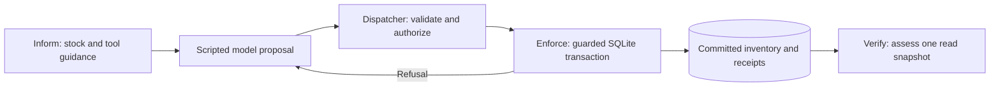

# Inform, Enforce, Verify

Scout needs one picnic snack. Apples are preferred, carrots are fine, and one
apple must stay in reserve. An unsafe pickup can move the last apple into Scout’s
hands and report success while the picnic still fails its business rule.

This example runs on Node.js 24.12+ with built-in SQLite and the Node test runner.
The model is scripted, so the same inputs and choices are easy to reproduce.

```sh
cd examples/inform-enforce-verify
npm ci
npm run demo -- all
npm test
```

The lockfile declares zero dependencies. The commands run without a database server
or model credentials.

## Read the code

| Start here                                                                                                           | What to look for                                                                     |
| -------------------------------------------------------------------------------------------------------------------- | ------------------------------------------------------------------------------------ |
| [`src/cli.ts`](src/cli.ts) and [`src/scenarios.ts`](src/scenarios.ts)                                                | CLI entry point, scripted decisions, and the isolated unsafe baseline.               |
| [`src/tool.ts`](src/tool.ts)                                                                                         | Model-facing tool definition, argument parsing, and authorization from host context. |
| [`src/inventory.ts`](src/inventory.ts), [`src/schema.sql`](src/schema.sql), and [`src/database.ts`](src/database.ts) | Conditional stock update, atomic transfer and receipt, schema, and seed data.        |
| [`src/verify.ts`](src/verify.ts)                                                                                     | The read snapshot and the decision about whether the picnic is complete.             |
| [`src/concurrency.ts`](src/concurrency.ts) and [`test/`](test/)                                                      | Two SQLite connections to one file, rollback, retries, and outcome checks.           |



## Inform: what the model sees

The tool registry holds the name, a base description, a JSON Schema for the
arguments, and two pieces of application guidance. It also holds the argument
parser and handler, which only application code uses. The adapter
`modelToolDefinition()` appends the two guidance strings to the description and
returns the name, expanded description, and schema. The `guidance` field itself
is local to the registry. A provider would only see the guidance because the
adapter put it into text the provider receives. [Registry and adapter](src/tool.ts#L38)

The tool definition in the CLI includes this description:

> Transfer stock from the pantry to Scout’s inventory. Preserve each item’s
> configured reserve minimum. Use the observed stock counts before proposing a
> withdrawal.

The current counts come from the database. For example, the fixture sees
`{ "itemId": "apple", "quantity": 1, "reservedMinimum": 1 }` in its stock input.
The description can stay the same when stock or reserve levels change. Run
`npm run demo -- C` to see the full tool definition and stock input, then see how
the refusal becomes part of the next decision. [Stock query](src/inventory.ts#L27)
· [Scripted model input](src/scenarios.ts#L27)

The schema requires a nonempty `itemId`, a positive safe-integer `quantity`,
and no extra properties. The proposal below has the right shape even when the
apple is reserved. Whether the pickup is allowed depends on the caller and
current stock. [Runtime argument parser](src/tool.ts#L18)

```json
{
  "name": "withdrawItem",
  "arguments": { "itemId": "apple", "quantity": 1 }
}
```

## Enforce: what the application allows

The dispatcher checks the tool name and parses the arguments. It then checks
whether the caller may withdraw for this task. Trusted application code
supplies the caller, allowed task IDs, target task, and operation ID separately.
Adding any of those fields to the model’s arguments fails validation. An
unauthorized request stops before the inventory handler runs.
[Dispatcher](src/tool.ts#L78) · [Validation and authorization test](test/unit.test.ts#L27)

Inside a SQLite write transaction, the update uses the **current** stock and
reserve. It only decrements the stock if enough units exist and the remainder
meets the reserve. The stock the model saw earlier may be stale. If the update
finds no eligible row, the service checks for a missing item, insufficient
stock, or a reserve violation in the same transaction. A successful withdrawal
decrements the pantry, credits Scout, and records the result together.
[Guarded update](src/inventory.ts#L71) · [Database constraints](src/schema.sql#L1)

In demo E, both workers open their own connections to the same SQLite file
before either request starts. Both ask for one apple when there are two apples
and one must remain. SQLite allows one writer at a time. After the first commit,
the second writer evaluates the guard against the remaining apple and receives
a reserve refusal. [Worker setup](src/concurrency.ts#L32)
· [Concurrency test](test/integration.test.ts#L200)

### Idempotency: what happens if the reply is lost?

Idempotency here means submitting the **same logical withdrawal** again does
not move another item. Imagine Scout asks to withdraw one apple from a pantry
with two apples. SQLite commits the transfer, but the caller loses the reply.
The caller retries with the same operation ID. The service returns the original
success result, and Scout still holds exactly one apple.

The host assigns the operation ID before dispatch. The service looks for that
ID in the `operations` table inside the same transaction it would use to change
stock. It compares the caller, task, item, and quantity with the stored request.

| Request                                                      | What happens                                                 |
| ------------------------------------------------------------ | ------------------------------------------------------------ |
| Same ID and same request after a success                     | Returns the stored success without another transfer.         |
| Same ID and same request after a business refusal            | Returns the stored refusal, even if stock has since changed. |
| Same ID with a different authorized, well-formed request     | Returns `OPERATION_ID_CONFLICT`.                             |
| New decision, such as trying a carrot after an apple refusal | Uses a new ID and checks current stock.                      |

Permission and argument checks still apply on retry. The stored result is a
receipt from the original attempt, so its remaining stock count is historical.
Read a fresh snapshot for current counts. If an error rolls the transaction
back before commit, neither inventory change nor a receipt survives. The
rollback test forces receipt insertion to fail after both inventory writes and
checks that a retry can then apply the withdrawal.
[Receipt lookup and comparison](src/inventory.ts#L50) · [Receipt table](src/schema.sql#L19)
· [Retry test](test/integration.test.ts#L126) · [Rollback test](test/integration.test.ts#L170)

## Verify: what actually counts as complete

`evaluatePicnicOutcome()` reads the pantry, Scout’s holdings for the task, and
successful operation IDs in one SQLite read transaction. The assessment uses
those facts. It does not take a model message or a tool result as input.
[Snapshot query](src/verify.ts#L55) · [Assessment rules](src/verify.ts#L26)

| Status       | Evidence                                                                                              |
| ------------ | ----------------------------------------------------------------------------------------------------- |
| `COMPLETED`  | Scout holds exactly one apple or carrot, and the reserve is intact.                                   |
| `INCOMPLETE` | Scout holds nothing, and there is a snack it can still take.                                          |
| `BLOCKED`    | The reserve was broken, holdings are unexpected, or an empty-handed Scout has no eligible snack left. |

In demo A, the unsafe pickup reports success while verification finds the
reserve broken. In demo B, the pantry protects the apple, but the task remains
incomplete even when the scripted model claims success. In demo C, Scout takes
a carrot after the refusal, and the next read confirms the task is complete.
[Unsafe baseline](src/scenarios.ts#L55) · [Recovery](src/scenarios.ts#L107)
· [Unsupported success claim test](test/integration.test.ts#L68)

## Reproduce the cases

Each case starts from fresh state. The output shows what the model fixture saw
and proposed, what the system did, and what the verifier concluded.

| Command             | What to look for                                                                                                   |
| ------------------- | ------------------------------------------------------------------------------------------------------------------ |
| `npm run demo -- A` | The deliberately unsafe in-memory transfer succeeds, but taking the last apple blocks the picnic.                  |
| `npm run demo -- B` | SQLite refuses the same request. The apple remains and the picnic is incomplete, despite a scripted success claim. |
| `npm run demo -- C` | The fixture sees the real refusal, requests a carrot, and completes the same picnic.                               |
| `npm run demo -- D` | With two apples, one can be taken while the reserve holds.                                                         |
| `npm run demo -- E` | Two workers use independent SQLite connections to one file. Either can win, but only one gets an apple.            |

Use `npm run test:unit` or `npm run test:integration` to run the checks separately.
The demos and tests clean up their temporary database files. For a database you
can keep and inspect, run `npm run db:init`. It creates and seeds
`.data/inventory.sqlite` without overwriting existing rows. Run
`npm run db:reset` to restore the seeds and clear the demo’s holdings and
receipts. To choose a different dedicated demo file, copy `.env.example` to
`.env` and set `UNKLEARN_INVENTORY_DB`.

## Limits and adaptation

The retry guarantee lasts as long as the receipt is retained in this database.
It does not cover side effects in another service. A lock timeout or I/O
failure surfaces as a database error, separate from a business refusal. The
example gets permissions from a trusted fixture. A deployed service would
supply that context through its own authentication and authorization layer.

The same pattern applies to refunds, quotas, and entitlements. Tell the model
the applicable limits, enforce them where the money or capacity changes, and
verify the intended result from the ledger, resource record, or entitlement
store.
